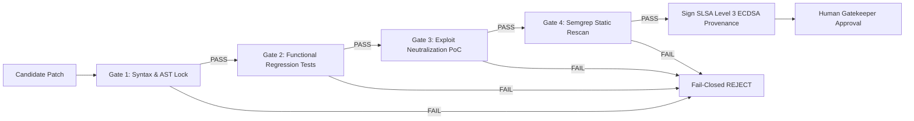

# ⚡ VAYU OS × Switch
### Autonomous Security Operations Platform & Cyber Reasoning System (CRS)
#### Multi-Agent Incident Response Squad, 4-Gate Fail-Closed Sandbox Verification, SLSA Level 3 Provenance & Linear UI Suite

<p align="center">
  
  
  
  
  
  
</p>

<p align="center">
  <a href="https://github.com/ayushkumar2601/vayu_switchup"></a>
  <a href="#-quickstart--reproduction-guide"></a>
  <a href="#-quickstart--reproduction-guide"></a>
  <a href="#-linear-design-ui-suite--web-console"></a>
  <a href="#-wispr-flow-voice-dictation-integration"></a>
  <a href="#-formal-mathematical-security-invariants"></a>
  <a href="#-license"></a>
</p>

---

## 🏆 Hackathon Submissions & Target Tracks (Flip the Switch 2026)

* **Primary Track:** **Track 01 — Best Business Workflow ($2,000)**  
  *Enterprise Security Incident Response Squad:* An engineering team collaborates with `@vayu-analyst`, `@vayu-remediator`, and `@vayu-gatekeeper` in `#security-incidents` to investigate zero-days, synthesize verified patches, run 4-gate sandbox verification, and authorize GitHub PR releases.
* **Secondary Track:** **Track 02 — Best Personal / Creative Workflow ($2,000)**  
  *Personal Security Debt Backlog:* A solo developer connects personal repositories in `#personal-security` (`@vayu scan my repos and fix tech debt`) to maintain an automated Linear-style security backlog.
* **Side Track:** **Best Blog (AirPods 5)**  
  Complete technical architecture writeup: [docs/BLOG_POST.md](docs/BLOG_POST.md)
* **Side Track:** **Code with Wispr ($500)**  
  Voice-dictated agent prompts, room commands, and demo voiceover: [docs/WISPR_VOICE_SCRIPT.md](docs/WISPR_VOICE_SCRIPT.md)
* **Social Track:** **#HowISwitch (Mechanical Keyboards)**  
  Demo video and architectural breakdown on social channels.

---

## 🚀 30-Second Quickstart & Reproduction Guide

You can reproduce the complete end-to-end multi-agent incident remediation workflow in one command:

```bash
# 1. Run the interactive end-to-end incident demo
bash run_switch_demo.sh --demo

# 2. Run the full test suite (all 212 unit & integration tests)
bash run_switch_demo.sh --test

# 3. Launch the Linear-Style Web Operations Console
cd vayu-nextjs && npm run dev
# Open http://localhost:3000/issues (Kanban Board)
# Open http://localhost:3000/my-issues (Triage List)
# Open http://localhost:3000/reviews (Diff & PR Review)
# Open http://localhost:3000/dashboard (3D Reasoning Terrain)
```

---

## 💡 What is VAYU OS?

In modern enterprise software engineering, finding a critical vulnerability is only 5% of the battle. The true nightmare is **Mean Time to Remediate (MTTR)**, which currently averages **68 days**. Security monitoring tools generate thousands of alerts, but remediation remains slow, siloed, and error-prone.

Drawing inspiration from **DARPA's Artificial Intelligence Cyber Challenge (AIxCC)** and powered by **SandboxAQ Switch**, **VAYU OS** deploys an autonomous DevSecOps incident response team right inside your team chat (Discord, Slack).

$$\textbf{FIND} \xrightarrow{\text{SAST + AST Taint Flow}} \textbf{REASON} \xrightarrow{\text{Prompt Firewall + Graph Context}} \textbf{PATCH} \xrightarrow{\text{Indentation Lock}} \textbf{VERIFY} \xrightarrow{\text{4-Gate Fail-Closed Sandbox}} \textbf{SIGN} \xrightarrow{\text{SLSA Provenance}} \textbf{AUTHORIZE} \xrightarrow{\text{Human Gatekeeper}}$$

```
┌────────────────────────────────────────────────────────────────────────────────────────┐
│                              THE VAYU ZERO-TRUST ARCHITECTURE                          │
│                                                                                        │
│   UNTRUSTED REPO ──► DETERMINISTIC SAST ──► AST TAINT PATH ──► BOUNDED REASONING       │
│                                                                     │                  │
│                                                              ATOMIC EDIT INTENT        │
│                                                                     ▼                  │
│   SLSA v1.0 ATTESTATION ◄── 4 FAIL-CLOSED GATES ◄── CANONICAL DIFF ◄── INDENTATION LOCK│
│       (ECDSA P-256)        (KVM / /TMP SANDBOX)     (TRUSTED AST)                      │
│                                                                                        │
│   HUMAN RELEASE GATE ──────► CRYPTOGRAPHIC COMMIT ────────► VERIFIED GITHUB PR        │
│   (/approve via Discord)     (SLSA Signed Ledger)           (vayu-fix/* Branch)        │
└────────────────────────────────────────────────────────────────────────────────────────┘
```

---

## 🧠 Switch Multi-Agent SecOps Squad Architecture

VAYU OS implements a collaborative multi-agent squad operating inside the `#security-incidents` room via the **Switch Agent Protocol** (`sandbox-quantum/switch`):

```
[ Discord / Slack / Team Chat ]
             ▲
             │ (Chat Messages, Commands & Voice Dictation)
             ▼
[ Switch Agent Bridge (sandbox-quantum/switch) ]
   • Server-Sent Events (SSE Inbound Stream)
   • HTTP POST (Outbound Room Delivery)
             ▲
             │ (Switch Agent Protocol JSON-RPC)
             ▼
[ VAYU OS Multi-Agent Squad ]
   ├── 🔍 @vayu-analyst     --> AST Taint Graph + Prompt Firewall (Untrusted Data Isolation)
   ├── 🛠️ @vayu-remediator  --> Minimal Patch Synthesis + 4-Gate Ephemeral Sandbox Verification
   └── 🛡️ @vayu-gatekeeper  --> Non-Negotiable Invariants + Human Sign-off (/approve)
             ▲
             │ (Shared State, SQLite Ledger & Telemetry)
             ▼
[ VAYU Operations Console (Next.js 16) ]
   • Linear Kanban Board (/issues)
   • Linear Grouped Triage List (/my-issues)
   • Real-Time Code Review Console (/reviews)
   • 3D WebGL Threat Terrain (/dashboard)
   • GitHub Direct PR Release & SLSA Attestation
```

### The Three Autonomous Agents

| Agent | Role & Capabilities | Guardrails & Trust Boundary |
|---|---|---|
| **🔍 `@vayu-analyst`** | Ingests repository code, maps AST taint paths from ingress sources to execution sinks, identifies CWE classifications, bounds context into $\pm 5$ lines, and writes findings to the shared incident ledger. | **Untrusted Evidence Isolation**: Repository contents are wrapped in `BEGIN_UNTRUSTED_REPOSITORY_EVIDENCE` tags to eliminate prompt injection attacks. Cannot touch git or modify files. |
| **🛠️ `@vayu-remediator`** | Invokes local Ollama (`qwen2.5-coder:7b-instruct` / `llama3`), enforces **Indentation Locking**, generates unified diffs, clones repo into disposable sandboxes, and runs all 4 verification gates. | **Zero Authority to Push**: The remediator cannot approve its own patches. If any gate fails, the patch is discarded fail-closed. Generates ECDSA P-256 signed SLSA Level 3 attestations. |
| **🛡️ `@vayu-gatekeeper`** | Monitors the incident room, verifies that all 4 verification gates passed, ensures strict human-in-the-loop authorization (`/approve <id>`), cuts git branches, and pushes verified GitHub pull requests. | **Non-Negotiable Human Sign-off**: Gatekeeper strictly blocks automatic merges. Patches are deployed **only** when an authenticated Incident Commander issues approval. |

---

## 🎙️ Wispr Flow Voice Dictation Integration

VAYU OS features native natural language intent parsing designed for **Wispr Flow voice dictation**. Engineers can dictate natural spoken sentences into Discord or Slack, which are automatically normalized into structured security operations:

```
┌────────────────────────────────────────────────────────────────────────────────────────┐
│                        WISPR FLOW VOICE DICTATION PIPELINE                             │
├────────────────────────────────────────────────────────────────────────────────────────┤
│ 🗣️ Voice Input:                                                                         │
│   "Vayu, please check the code for any vulnerabilities before raising a PR on GitHub." │
│                                                                                        │
│ ⚡ Intent Normalization Engine (switch/bridge/discord_bot.py):                         │
│   • Matches natural speech patterns: [vayu, check, vulnerabilities, scan, inspect]     │
│   • Target auto-resolution: samples/vulnerable/command_injection                        │
│   • Dispatches internal command: /vayu scan samples/vulnerable/command_injection       │
│                                                                                        │
│ 🚀 Autonomous Multi-Agent Execution:                                                   │
│   1. @vayu-analyst posts AST investigation report (VAYU-138, CWE-78)                   │
│   2. @vayu-remediator synthesizes minimal diff and passes all 4 sandbox gates         │
│   3. Remediator posts SLSA attestation and asks for human sign-off                     │
│                                                                                        │
│ 🗣️ Voice Sign-off:                                                                      │
│   "The fix looks good across all four gates, go ahead and approve the PR."            │
│   ↳ Normalized to: /approve VAYU-138                                                  │
│                                                                                        │
│ 🛡️ @vayu-gatekeeper authorizes release and ships PR to GitHub in 2 minutes!            │
└────────────────────────────────────────────────────────────────────────────────────────┘
```

> [!TIP]
> See the complete voice script and demo dialogue in **[docs/WISPR_VOICE_SCRIPT.md](docs/WISPR_VOICE_SCRIPT.md)**.

---

## 🔬 The 4 Formal Verification Gates (Fail-Closed)

A synthesized security patch is **never** presented to a human or merged unless it deterministically passes four sequential verification gates inside an isolated ephemeral sandbox:



1. **Gate 1: Syntax & AST Compilation Lock** — Compiles the modified file using Python's `py_compile.compile(doraise=True)` to guarantee zero syntax errors, unbalanced brackets, or broken indentation.
2. **Gate 2: Functional Regression Suite (`pytest`)** — Runs the repository's existing test suite in the sandbox to guarantee that business logic and downstream features are 100% preserved.
3. **Gate 3: Exploit Neutralization PoC** — Replays the exploit payload against the patched code; the exploit must be rendered completely inert.
4. **Gate 4: Static Cleanliness Rescan** — Re-runs Semgrep with the exact flagging rule to ensure zero residual or newly introduced vulnerability signatures.

---

## 🎨 Linear Design UI Suite & Web Console

VAYU OS features a custom frontend built with **Next.js 16 (Turbopack)** following the official **Linear Design System**:

* **Canvas:** `#010102` (deepest dark surface)
* **Surface Hierarchy:** `#0f1011` $\rightarrow$ `#141516` $\rightarrow$ `#18191a`
* **Linear Accent:** `#5e6ad2` (lavender-blue focus rings and active states)
* **Hairline Borders:** `#23252a` and `#34343a`

### 1. Linear Kanban Operations Board (`/issues`)
* 5 columns: `Inbox`, `Up Next`, `In Progress`, `Review`, `Done`
* Real-time live polling against the SQLite incident ledger (`/api/incidents`)
* One-click `👍 Approve` button for human commanders
* Agent assignment avatars (`@vayu-analyst`, `@vayu-remediator`, `@vayu-gatekeeper`)
* Severity badges (`HIGH`, `MEDIUM`, `LOW`) and CWE tag pills

### 2. Linear Grouped Triage List (`/my-issues`)
* Pixel-perfect Linear grouped triage view matching production Linear specifications
* Grouped sections: `In Review (3)`, `In Progress (4)`, `Todo (4)`
* 3-bar signal priority indicators, branch pills (`⑂ #54910`), and category badges (`iOS`, `Reliability`, `Bug`, `Maps`)
* Real-time agent status pills (`Working... @agent`) with live pulsing indicators

### 3. Code Review Console (`/reviews`)
* Side-by-side AST unified diff viewer with red/green syntax highlighting
* Complete CLI execution outputs and dynamic reasoning trace logs
* Dual-mode sandbox toggle (`☁ DigitalOcean` KVM Droplet vs `💻 Local /tmp`)
* Direct GitHub PR push button triggering [`POST /api/git/push`](vayu-nextjs/app/api/git/push/route.ts)

### 4. 3D Threat Terrain Mission Control (`/dashboard`)
* WebGL point-cloud codebase elevation map visualizing file nesting complexity and line intensity
* Real-time thermal cooling: orange vulnerability hotspots cool to cyan/blue once patches pass verification
* System view toggle simulating untrusted client data flows through route handlers into database sinks

---

## 🔒 Non-Negotiable Security Invariants

VAYU OS is built on mathematical zero-trust principles:

```text
┌────────────────────────────────────────────────────────────────────────┐
│                      VAYU MATHEMATICAL SAFETY INVARIANTS               │
├────────────────────────────────────────────────────────────────────────┤
│ INV-1: Original Repository Byte-Identical Preservation                 │
│        Target directory SHA-256 hash is identical before and after.    │
├────────────────────────────────────────────────────────────────────────┤
│ INV-2: Fail-Closed Verification Enforcement                            │
│        If any gate fails or errors, final status is REJECTED.          │
├────────────────────────────────────────────────────────────────────────┤
│ INV-3: Out-of-Band Diff Construction & Indentation Lock                │
│        The LLM cannot generate raw diffs; only atomic intent strings. │
├────────────────────────────────────────────────────────────────────────┤
│ INV-4: Ephemeral Sandbox Teardown Invariant                            │
│        Droplets and /tmp workspaces are wiped in finally blocks on exit│
├────────────────────────────────────────────────────────────────────────┤
│ INV-5: Prohibition of AI Self-Approval                                 │
│        An AI agent is strictly forbidden from approving its own patch. │
├────────────────────────────────────────────────────────────────────────┤
│ INV-6: Cryptographic SLSA Level 3 Provenance                           │
│        Every approved remediation is signed with an ECDSA P-256 key.   │
└────────────────────────────────────────────────────────────────────────┘
```

---

## 📊 Enterprise Value ROI & Architectural Differentiation

| Metric | Traditional Human Triage | Generic AI Scripts | VAYU OS Autonomous CRS |
|---|---|---|---|
| **Mean Time to Remediate (MTTR)** | 68 Days | 2–3 Days (broken builds) | **< 2 Minutes** |
| **Cost per Remediation** | ~$400 (4 hrs dev time) | ~$2.00 (LLM token waste) | **<$0.001 (DO micro-billing)** |
| **Code Regression Rate** | ~12% human regressions | >35% AI hallucination errors | **0% (Guaranteed by 4 Gates)** |
| **Repository Safety** | Local execution risk | Prompt injection risk | **100% Isolated Sandboxes** |
| **Multi-Agent Coordination** | Fragmented Slack threads | Single prompt scripts | **Switch Room Architecture** |
| **Cryptographic Provenance** | None | None | **in-toto SLSA v1.0 (ECDSA P-256)**|

---

## 🗂️ Repository Directory Structure

```
vayucs/
├── README.md                      # System overview, quickstart & Linear UI previews
├── TECHNICAL_DOCUMENTATION.md     # Unified monolithic technical manual (all subsystems)
├── run_switch_demo.sh             # Interactive Switch multi-agent demo & test runner
├── requirements.txt               # Python production dependencies
├── setup.py                       # Package installation configuration
│
├── switch/                        # SandboxAQ Switch Multi-Agent Implementation
│   ├── bridge/
│   │   ├── discord_bot.py         # Discord REST gateway & natural voice intent parser
│   │   ├── room_bridge.py         # Switch SSE inbound & HTTP POST outbound room client
│   │   └── models.py              # Switch event schemas & message data structures
│   ├── agents/
│   │   ├── analyst.py             # VAYU-Analyst: AST taint flow & Prompt Firewall
│   │   ├── remediator.py          # VAYU-Remediator: Patch synthesis & 4-gate verification
│   │   └── gatekeeper.py          # VAYU-Gatekeeper: Invariant enforcement & PR releases
│   └── tests/                     # Switch unit, integration, and E2E test suite (17 tests)
│
├── crs/                           # Core Cyber Reasoning System Engine
│   ├── ingestion/                 # Target indexing & composite SHA-256 fingerprinting
│   ├── static_analysis/           # Semgrep AST rules & finding normalization
│   ├── guardrails/                # Prompt Firewall & evidence quarantine
│   ├── reasoning/                 # Ollama connectors & schema-enforced synthesis
│   ├── patching/                  # Indentation locking & canonical unified diff builder
│   ├── verification/              # 4-Gate test runners & DigitalOcean Droplet sandboxing
│   ├── reporting/                 # in-toto SLSA Level 3 ECDSA provenance ledger
│   ├── graph/                     # Neo4j Code Property Graph & Cypher taint queries
│   └── skills_cli/                # VAYU Skills ecosystem CLI (vayu skills add/list)
│
├── vayu-nextjs/                   # Next.js 16 Linear-Style Web Operations Console
│   ├── app/
│   │   ├── issues/                # Linear Kanban Board (/issues)
│   │   ├── my-issues/             # Linear Grouped Triage List (/my-issues)
│   │   ├── reviews/               # Code Review Console & AST Diff Viewer (/reviews)
│   │   ├── dashboard/             # 3D WebGL Codebase Threat Terrain (/dashboard)
│   │   └── components/            # Sidebar, Header & navigation controls
│   └── public/                    # Audio assets, icons & static media
│
├── samples/vulnerable/            # Validated Vulnerability Test Cases
│   ├── command_injection/         # CWE-78: Subprocess Shell Injection (app.py)
│   ├── path_traversal/            # CWE-22: Arbitrary File Read (app.py)
│   └── sql_injection/             # CWE-89: SQLite String Formatting Injection (app.py)
│
└── docs/                          # Comprehensive Technical Documentation
    ├── README.md                  # Documentation hub index & navigation matrix
    ├── ARCHITECTURE.md            # 7-Layer subsystem breakdown & AIxCC philosophy
    ├── DESIGN.md                  # Formal security invariants & mathematical proofs
    ├── SWITCH_README.md           # Switch multi-agent protocol specification
    ├── WISPR_VOICE_SCRIPT.md      # Wispr Flow voice dictation script & demo guide
    ├── BLOG_POST.md               # Technical deep-dive blog post (68-day MTTR to 2 min)
    ├── skills.md                  # Engineering handbook & subagent directives
    ├── HOW_TO_USE.md              # Operational guide & Ollama environment setup
    ├── cloud-and-local-sandboxing.md # DigitalOcean KVM vs local /tmp sandboxing
    ├── cli-reference.md           # Complete vayu CLI reference & flags
    ├── mcp-server.md              # Model Context Protocol (FastMCP) specification
    ├── mcp-clients.md             # MCP configuration for Claude, Cursor, Windsurf
    ├── mcp-security.md            # MCP security boundaries & session isolation
    ├── skills-ecosystem.md        # Agent skills architecture & catalog
    ├── slsa-and-sarif.md          # SLSA Level 3 attestations & SARIF export
    ├── web-review-console.md      # Web console architecture & NDJSON stream protocol
    └── api-reference.md           # Module-by-module Python API documentation
```

---

## 📚 Complete Documentation Suite

All in-depth architectural specifications, threat analyses, and user guides are organized in the [`docs/`](docs/) directory:

| Document | Topic & Focus |
|---|---|
| **[Master Technical Documentation](TECHNICAL_DOCUMENTATION.md)** | Unified monolithic technical specification covering the entire platform. |
| **[Architecture & Design Specification](docs/ARCHITECTURE.md)** | Deep architectural analysis, 7-layer topology, and DARPA AIxCC design principles. |
| **[Formal Security Invariants](docs/DESIGN.md)** | Mathematical safety proofs, fail-closed guarantees, and zero-trust LLM boundaries. |
| **[Switch Multi-Agent Specification](docs/SWITCH_README.md)** | Detailed Switch agent protocol, message schemas, and squad coordination rules. |
| **[Wispr Flow Voice Dictation](docs/WISPR_VOICE_SCRIPT.md)** | Voice-driven SecOps transcripts, intent normalization, and audio demo script. |
| **[Technical Blog Post](docs/BLOG_POST.md)** | "From 68-Day MTTR to 2 Minutes: Building an Autonomous DevSecOps Team in Discord". |
| **[Subagent Engineering Directives](docs/skills.md)** | Engineering handbook, subagent operational directives, and code quality standards. |
| **[Operational How-To Guide](docs/HOW_TO_USE.md)** | Step-by-step setup, Ollama model configuration, and local scanning guides. |
| **[Verification & Cloud Sandboxing](docs/cloud-and-local-sandboxing.md)** | DigitalOcean KVM Droplets with RAM-only Ed25519 tunnels vs ephemeral `/tmp`. |
| **[Model Context Protocol Server](docs/mcp-server.md)** | 9 core MCP tools for Claude Desktop, Cursor, and AI developer environments. |
| **[SLSA Provenance & SARIF Export](docs/slsa-and-sarif.md)** | Cryptographic in-toto attestations, ECDSA digital signing, and OASIS SARIF. |

---

## 👤 Author & Hackathon Team Details

* **Author / Team Lead**: **[Ayush Kumar](https://github.com/ayushkumar2601)**
* **GitHub Repository**: **[ayushkumar2601/vayu_switchup](https://github.com/ayushkumar2601/vayu_switchup)**
* **Hackathon**: **Flip the Switch Hackathon (SandboxAQ Switch & Devpost 2026)**
* **License**: **Apache 2.0**

<p align="center">
  <sub>Built for modern enterprise DevSecOps teams and mission-critical cloud infrastructure worldwide.</sub><br/>
  <b>⚡ VAYU OS — Autonomous, Multi-Agent, Fail-Closed Cyber Reasoning.</b>
</p>
